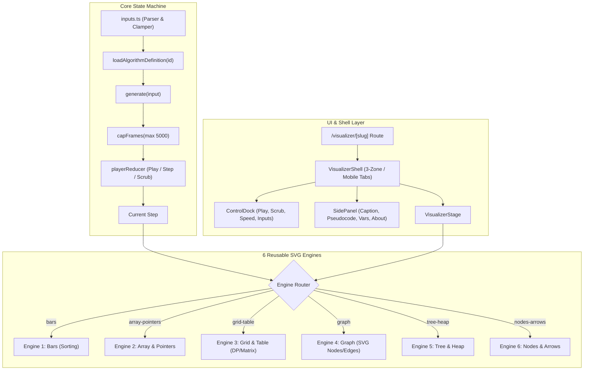

# Iwons Algorithm Visualizer Architecture

Date: 2026-10-17  
Author: Principal Software Engineer  

---

## 1. Core Principles & Boundaries

The Iwons Algorithm Visualizer is built on strict software boundaries designed to scale to 250+ algorithms without bundle bloat, state leaks, or UI degradation:

1. **Separation of Concerns:**
   - **Algorithm Logic:** 100% pure functions (`generate(input) => Step[]`). No DOM access, no React imports, no side-effects, no global mutable state.
   - **Engines:** Dumb, pure view components. An engine receives a single `Step` snapshot and renders SVG elements into a responsive `viewBox`.
   - **Player:** A deterministic state machine (`playerReducer`) that handles play, pause, stepping, scrubbing, speed, and frame budgeting.
   - **Shell:** Responsive layout manager (3-zone desktop, tabbed mobile) holding controls, caption, pseudocode, and variable inspection.
2. **Deterministic & Seeded:**
   - Presets use a lightweight seeded PRNG (`createRng` xorshift32) to ensure any edge case or failure mode is 100% reproducible.
3. **Zero Runtime Dependencies:**
   - No D3, no Framer Motion, no canvas libraries, no chart packages.
   - High-performance declarative SVG with CSS transitions (`transform`, `opacity`), hardware acceleration, and instant jump under `prefers-reduced-motion`.
4. **On-Demand Loading:**
   - `src/visualizer/registry.ts` holds metadata only (~40KB). Heavy generator code and pseudocode strings load via dynamic `import()` only when that algorithm is opened.

---

## 2. Layered Architecture & Data Flow



### Data Flow Lifecycle
1. **User Action:** User selects a preset or modifies the custom input field.
2. **Input Validation:** `parseNumberList`, `parseTargetAndNumbers`, etc. validate and clamp parameters.
3. **Generator Execution:** The pure generator runs synchronously, emitting an array of `Step` snapshots.
4. **Frame Capping:** If total steps exceed `MAX_FRAMES_CAP` (5,000), frames are deterministically sampled, preserving boundary steps, and notifying the user.
5. **Playback Dispatch:** `playerReducer` manages playback tick timeouts (`setTimeout` scaled by `speedMs`), dispatching `STEP_FORWARD` or responding instantly to `JUMP_TO` (scrubbing).
6. **SVG Rendering:** The active engine receives the current `Step` and computes SVG elements (`rect`, `circle`, `line`, `text`, `path`) using design tokens (`var(--ink)`, `var(--surface)`, `var(--accent)`, `var(--border-dim)`).

---

## 3. The 6 Reusable Engines

| Engine | Primary Topics | Visual Primitives | Marks & States |
| --- | --- | --- | --- |
| **1. Bars** | Sorting (Bubble, Merge, Quick, Heap, Radix, Shell, etc.) | SVG `<rect>` bars, value text labels, auxiliary row `<g>` | `compared`, `swapped`, `sorted`, `pivot`, `range`, `selected` |
| **2. Array & Pointers** | Search, Sliding Window, Two Pointers, Strings (KMP, Z-algo) | Horizontal cell row, floating named pointer arrows, bracket ranges | `checking`, `found`, `window`, `eliminated`, `match`, `mismatch` |
| **3. Grid & Table** | DP tabulation, Matrix traversals, Backtracking (N-Queens, Sudoku) | 2D cell grid, row/col headers, diagonal & orthogonal traceback paths | `current`, `source`, `computed`, `visited`, `path`, `wall`, `candidate` |
| **4. Graph** | Traversals (BFS, DFS), Shortest Paths (Dijkstra), MST (Prim, Kruskal) | Node circles, edge lines, arrow markers, side queue/stack panel | `current`, `frontier`, `visited`, `tree`, `back`, `in-path`, `active` |
| **5. Tree & Heap** | Binary Trees, BST, AVL, Tries, Heaps (tree + synchronized array) | Hierarchical tree nodes, connecting lines, array strip below | `current`, `visited`, `inserted`, `rotated`, `swapped`, `sorted` |
| **6. Nodes & Arrows** | Linked Lists, Stacks & Queues, Hash Tables (chaining/open), LRU | Pointer-linked boxes, `next`/`prev` arrows, head/tail tags, bucket rack | `active`, `current`, `target`, `removed`, `added` |

---

## 4. How to Add a New Algorithm (Recipe)

Adding any new algorithm requires **only one data file** and a single registry entry. No edits to the player, engines, or UI shell are ever required.

### Step 1: Create Data File
Create `src/visualizer/algorithms/[category]/[slug].ts`:
```ts
import { AlgoDefinition, BarsStep } from '../../core/types';

export const myAlgorithmDef: AlgoDefinition<number[]> = {
  id: 'my-algorithm',
  name: 'My Algorithm',
  category: 'sorting',
  engine: 'bars',
  complexity: { best: 'O(n)', average: 'O(n log n)', worst: 'O(n²)', space: 'O(1)' },
  inputKind: 'numbers',
  blurb: 'Brief 2-3 sentence description explaining the core concept.',
  pseudocode: [
    'procedure myAlgo(A):',
    '  // line 1...',
  ],
  presets: [
    { name: 'default', label: 'Default Array', input: [12, 4, 8, 19, 1] },
  ],
  generate(input: number[]): BarsStep[] {
    const steps: BarsStep[] = [];
    // Record step frames:
    steps.push({
      engine: 'bars',
      caption: 'Initial state of the array.',
      line: 1,
      bars: { values: [...input] },
    });
    return steps;
  },
};
export default myAlgorithmDef;
```

### Step 2: Register in `src/visualizer/registry.ts`
1. Add metadata object to `ALGORITHM_REGISTRY`.
2. Add dynamic loader to `ALGO_LOADERS`:
   ```ts
   'my-algorithm': () => import('./algorithms/category/my-algorithm'),
   ```

### Step 3: Automated Verification
Add unit test verifying that the final frame produced by `generate()` matches the oracle (e.g. sorted array, shortest distance, DP answer).

---

## 5. Architectural Trade-offs & Decisions

1. **Precomputed Frame Recording vs Live Execution:**
   - *Trade-off:* Recording all frames upfront takes a brief synchronous pass before playback starts, but enables instantaneous backward stepping, drag scrubbing, jump-to-end, and deterministic oracle testing.
   - *Mitigation:* Heavy inputs are capped via input validators and `capFrames` limits output to 5,000 steps, preventing browser freezes.
2. **SVG ViewBox vs HTML Canvas:**
   - *Trade-off:* Canvas is slightly faster for 10,000+ simultaneous particles, but SVG provides superior typography, crisp vector rendering on Retina/HiDPI screens, accessibility tree integration (`aria-label`, semantic elements), and native CSS styling with design tokens.
   - *Decision:* SVG with memoized geometries was selected as the optimal fit for retro paper/typewriter design.
3. **Registry Dynamic Imports:**
   - *Decision:* Instead of bundling 200+ algorithms into the main page bundle, `registry.ts` contains only lightweight metadata (IDs, names, complexities). The actual generator is dynamically imported via `loadAlgorithmDefinition` when the route is loaded.

